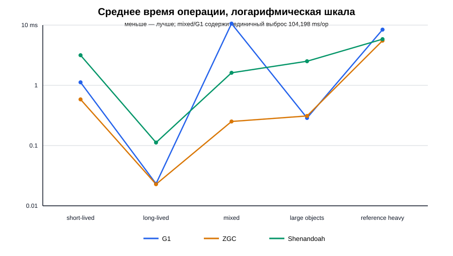
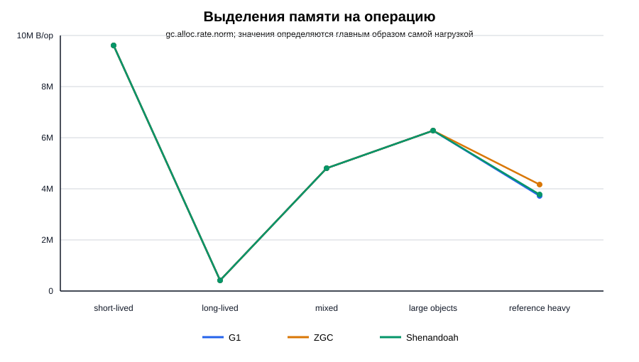

# Сравнение G1, ZGC и Shenandoah

## Что проверялось

В работе сравнивались три сборщика мусора Java: G1, ZGC и Shenandoah. Нужно было дать им несколько разных типов нагрузки и посмотреть, как меняются
скорость программы, количество выделяемой памяти и паузы GC

Во всех запусках размер кучи был одинаковым: `-Xms2g -Xmx2g`. Использовались
JDK Temurin 21.0.10 и JMH. Каждый тест запускался в двух отдельных процессах
JVM. В каждом процессе выполнялись три прогревочные и пять измеряемых итераций
по 10 секунд

## Нагрузки

| Нагрузка | Что она имитирует |
|---|---|
| `short-lived-garbage` | Много маленьких объектов, которые почти сразу становятся ненужными |
| `long-lived-objects` | Объекты, которые остаются в памяти между запусками нагрузки |
| `mixed` | Одновременно создаётся обычный мусор и часть объектов живёт дольше |
| `largeObjects` | Крупные массивы по 2 мебибайт |
| `referenceHeavy` | Карта со слабыми ключами и мягкими ссылками на значения |

В каждой нагрузке результат сохраняется в поле `sink`. Это важно, потому что без этого
JVM могла бы понять, что созданные объекты никому не нужны, и вообще не
выделять под них память

## Как запускалось

```text
.\gradlew.bat jmh -PjmhJvmArgs="-XX:+UseG1GC -Xms2g -Xmx2g -Xlog:gc*:file=logs/g1-%p.log:time,uptime,level,tags"
.\gradlew.bat jmh -PjmhJvmArgs="-XX:+UseZGC -Xms2g -Xmx2g -Xlog:gc*:file=logs/zgc-%p.log:time,uptime,level,tags"
.\gradlew.bat jmh -PjmhJvmArgs="-XX:+UseShenandoahGC -Xms2g -Xmx2g -Xlog:gc*:file=logs/shenandoah-%p.log:time,uptime,level,tags"
```

Исходные результаты JMH лежат в `docs/results/`, а логи сборщиков — в `logs/`

## Результаты по времени

Чем меньше значение, тем быстрее выполнилась одна операция

| Нагрузка | G1, ms/op | ZGC, ms/op | Shenandoah, ms/op |
|---|---:|---:|---:|
| `short-lived-garbage` | 0.880 | **0.583** | 3.135 |
| `long-lived-objects` | **0.021** | 0.023 | 0.114 |
| `mixed` | 10.665* | **0.250** | 1.615 |
| `largeObjects` | **0.289** | 0.314 | 2.511 |
| `referenceHeavy` | 7.178 | **5.531** | 5.800 |

\* У G1 на нагрузке `mixed` один замер неожиданно занял 104.198 ms/op, хотя
остальные были около 0.24–0.46 ms/op. Из-за этого среднее значение для G1
получилось завышенным. Результат сохранён как есть в JSON: он не удалялся и не
исправлялся вручную



По этим запускам ZGC лучше всего справился с короткоживущим мусором, смешанной
нагрузкой и работой со ссылками. G1 оказался чуть быстрее, когда объекты жили
долго или создавались большие массивы. Shenandoah в этой конфигурации чаще
проигрывал по времени

## Сколько памяти выделялось

Здесь указано, сколько байт выделялось на одну операцию. В первых четырёх
нагрузках цифры почти одинаковые: объём памяти в основном задаёт код самой
нагрузки, а не выбранный сборщик мусора

| Нагрузка | G1, B/op | ZGC, B/op | Shenandoah, B/op |
|---|---:|---:|---:|
| `short-lived-garbage` | 9,600,000 | 9,600,000 | 9,600,000 |
| `long-lived-objects` | 417,600 | 417,600 | 417,600 |
| `mixed` | 4,813,440 | 4,813,440 | 4,813,440 |
| `largeObjects` | 6,291,504 | 6,291,504 | 6,291,504 |
| `referenceHeavy` | 3,724,435 | 4,179,100 | 3,774,907 |



На `referenceHeavy` цифры немного отличаются. Это нормально: слабые и мягкие
ссылки очищаются в разные моменты, поэтому работа кучи не полностью совпадает
между запусками

## Логи GC

### G1

У G1 видны обычные паузы молодого поколения (`Pause Young`). На нагрузке с
короткоживущими объектами они часто занимали около 2–4 ms. На крупных массивах
в логах появилась отдельная обработка `Humongous Allocation`: например,
количество humongous-регионов уменьшилось с 921 до 3 за паузу 3.649 ms

В файле `logs/g1-jstat.txt` доля Old выросла с 26.36% до 33.03%. Это логично:
часть объектов из нагрузок переживает несколько молодых сборок

### ZGC

У ZGC основная работа проходит одновременно с программой. В логах короткие
паузы `Pause Mark Start` и `Pause Mark End` занимают сотые доли миллисекунды.
Поэтому приложение почти не останавливается на этапе маркировки. Это хорошо
согласуется с быстрыми результатами ZGC на нагрузках, где много аллокаций

### Shenandoah

Shenandoah тоже большую часть работы делает конкурентно. В логах его короткие
паузы обычно небольшие, а эвакуация выполняется в конкурентной фазе. Но на
моём запуске он всё равно оказался медленнее двух других сборщиков. Вероятно,
сказалась стоимость дополнительных барьеров и то, что в логах указано только
четыре concurrent worker-потока

## Итог

На моём компьютере победителя не получилось. ZGC показал лучшую
или почти лушчую скорость на большинстве нагрузок и очень короткие паузы. G1
лучше проявил себя на долгоживущих и больших объектах, но у него есть обычные
паузы, когда приложение останавливается для работы GC. Shenandoah тоже держит
паузы небольшими, но в этих конкретных тестах оказался медленнее

Это не значит, что один GC всегда лучше другого: результат зависит от версии
JDK, размера кучи, процессора, характера нагрузки и настроек запуска
